<p align="center">
  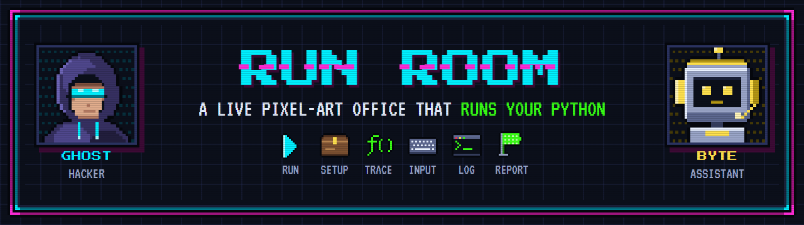
</p>

<h3 align="center">Run your own Python code and watch a pixel-art crew carry it out.</h3>

<p align="center">
  Every function call, every return value and every <code>input()</code> question shows up live,<br>
  in one shared office that every browser sees at the same moment.
</p>

<p align="center">
  
  
  
  
  
  
  
</p>

<p align="center">
  <a href="#quick-start"><b>Quick start</b></a> |
  <a href="#features"><b>Features</b></a> |
  <a href="#screenshots"><b>Screenshots</b></a> |
  <a href="#how-a-run-works"><b>How a run works</b></a> |
  <a href="#share-it-with-other-people"><b>Share it</b></a> |
  <a href="#architecture"><b>Architecture</b></a> |
  <a href="#the-art-pipeline"><b>Art</b></a> |
  <a href="#faq-and-troubleshooting"><b>FAQ</b></a>
</p>

<p align="center">
  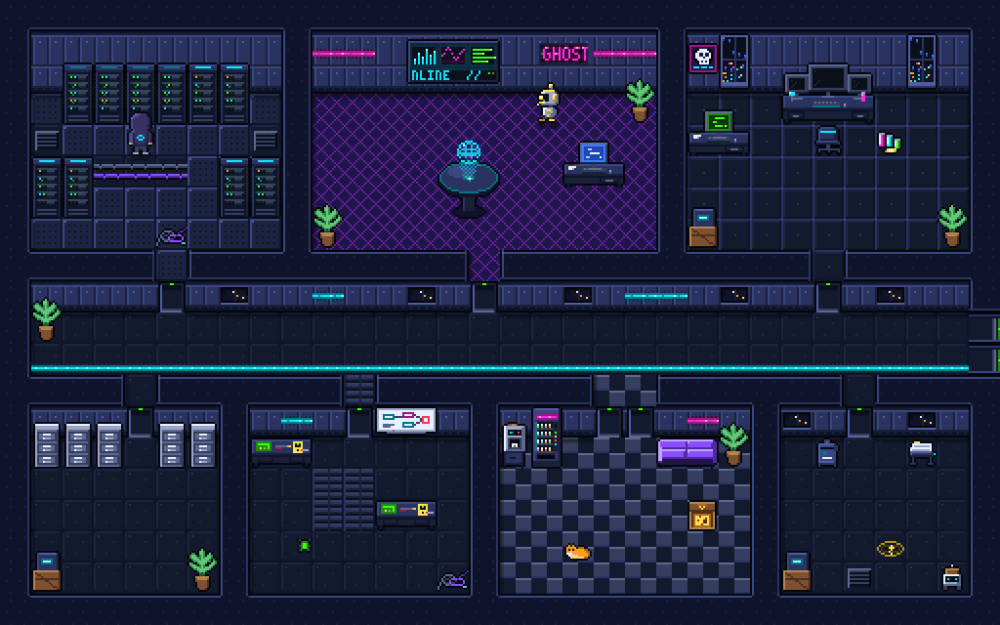
</p>

> [!WARNING]
> RUN ROOM runs **real code** on the computer that runs its server, as a normal process with
> your own permissions. It is **not a security sandbox**. Only run code you wrote yourself or fully
> trust, and read the [security model](#security-model) before you let other people in.

---

## Table of contents

- [What is RUN ROOM?](#what-is-run-room)
- [Features](#features)
- [Screenshots](#screenshots)
- [Quick start](#quick-start)
- [How a run works](#how-a-run-works)
- [Using the office](#using-the-office)
- [Running Python: the rules](#running-python-the-rules)
- [Share it with other people](#share-it-with-other-people)
- [Configuration](#configuration)
- [Security model](#security-model)
- [Architecture](#architecture)
- [The art pipeline](#the-art-pipeline)
- [Checks and tests](#checks-and-tests)
- [FAQ and troubleshooting](#faq-and-troubleshooting)
- [Contributing](#contributing)
- [Credits](#credits)

---

## What is RUN ROOM?

RUN ROOM is a small pixel-art office in your browser that runs real Python programs: yours.
You give it a `.py` file or a whole project folder, type the run command, and the crew takes over.
**Byte**, the robot assistant, carries your code to **Ghost's** PC and installs its dependencies
at the server racks. **Ghost**, the hooded hacker, runs it while his thought bubbles show which
function is running and his speech bubbles show what it returned. Whenever the program calls
`input()`, a prompt pops up for you to answer. When it ends, you get a full report.

The office is simulated on the server, so every browser that opens it (a second tab, your phone,
a friend's laptop) sees the same office, the same crew and the same run at the same moment. Every
piece of art, from the floor tiles to the mouse cursor, is drawn by code in this repository.
Nothing is downloaded.

It is a playful way to *see* what a program does. The hacker look is only a theme: there is no
real hacking, scanning or exploitation anywhere in RUN ROOM.

### Meet the crew

<table>
  <tr>
    <td align="center" width="50%"><br><b>GHOST</b>, the hacker</td>
    <td align="center" width="50%"><br><b>BYTE</b>, the assistant</td>
  </tr>
  <tr>
    <td>Runs every program at his PC and thinks out loud while it runs: each call in a thought bubble, each return value (with its type) in a speech bubble. A crash makes him facepalm at a red screen. Between jobs he checks the feeds on the Command Center wall, brews coffee, sketches on the whiteboard and naps on the couch.</td>
    <td>Picks your code up in the Mail Room, brings it to Ghost, runs the setup commands at the server racks and carries the result back to the Mail Room. Between jobs he patrols, waters the plants, pets the cat, sorts the mail, recharges and brings Ghost coffee.</td>
  </tr>
</table>

<p align="center">
  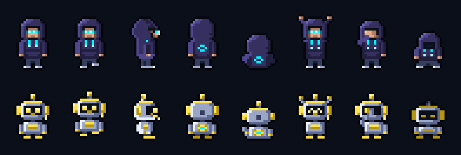
</p>

---

## Features

**Run your own Python**

- **One file:** drop or pick a `.py` file (up to 1 GB). The run command is filled in for you.
- **A whole project:** pick its folder (up to 2000 files and 1 GB) or a `.zip` of it (the way to
  upload a project from a phone). Virtual environments, `.git` and caches are left out. The run
  box lists the project's `.py` files (click one to run it) and suggests
  `pip install -r requirements.txt` when it finds a requirements file.
- **Setup commands** (optional) run once in a private virtual environment per project, so
  `pip install` never touches your system Python.
- **Checked as you type** with the same rules the server uses: `python main.py --size 3`,
  `python src/app.py`, `python -m mypackage`, `python -c "..."`.

**See what your program is doing**

- **RUN MONITOR:** the function running right now with its file and line, the call stack, the last
  values returned with their type (and the declared return annotation, shown in red when they do
  not match), the busiest functions and live counters.
- **The crew reacts:** Ghost's bubbles show each call with its arguments and each value that came
  back; the Command Center wall shows the current function and line; Byte reads out new output.
- **Terminal tabs:** ALL, OUTPUT (stdout, stderr, your answers, setup output), TRACE
  (`CALL` / `RET` / `YIELD` / `RAISE` lines), CREW and SYS.
- **Only your code is traced:** files inside the project folder. The standard library and
  installed packages are skipped. Python 3.12+ uses `sys.monitoring`, older versions `sys.setprofile`.

**Answer `input()` live**

- `input()`, `getpass.getpass()` and reads from `sys.stdin` open a full-screen prompt for every
  viewer, with the question and the program's last output lines. The first answer wins.
- **END INPUT** (Ctrl+D) closes the program's input, **STOP PROGRAM** kills it, Escape tucks the
  prompt into a blinking chip while the program keeps waiting.
- Hidden input (`getpass`) is masked everywhere, the report included.

**Reports and saved projects**

- When a run is delivered the **Result** panel opens: outcome and exit code, the uncaught
  exception, every traced function (calls, return types, declared type, last value), your inputs,
  the output and the files the program created or changed. **SAVE REPORT** downloads it as Markdown.
- **SAVE AS** stores the code and its commands under a name. Saved projects run with one click
  (the three most recently saved sit above the queue), and their setup only runs again when the
  commands or the code change.

**One office on every screen**

- The simulation runs on the server at 60 ticks per second. Browsers mirror one clock and draw
  the same deterministic movement, so two tabs agree to within a few milliseconds. A late joiner
  gets a snapshot (including an open input question) and is in sync at once.
- Pause / resume and 1X / 2X / 4X speed are shared. Sound, CRT filter, night mode, camera follow
  and the typewriter terminal are per viewer.
- **Phones and tablets:** the side panels become tabs under the office, the agent card becomes a
  bottom sheet, the input prompt fits above the on-screen keyboard, and swiping over the office
  scrolls the page smoothly.

**Guests and admins**

- Watching is open to everyone. With an admin password set, running code and every other command
  (pause, speed, coffee, even petting the cat) needs that password, and the server enforces it,
  not just the UI.

**Pixel art made by code**

- Every tile, prop, character, icon, mood face, cursor, bitmap font and 9-slice UI frame is drawn
  by `tools/assets` with one fixed palette: no downloaded art, no icon fonts, no emoji. Sprites
  render at whole-number zoom only (1x, 2x, 3x ...). Even the sound effects are generated.
- When nothing runs, the office lives on: idle routines, a cat, rain on the windows, blinking
  server racks, a night mode and a CRT filter.

---

## Screenshots

<p align="center">
  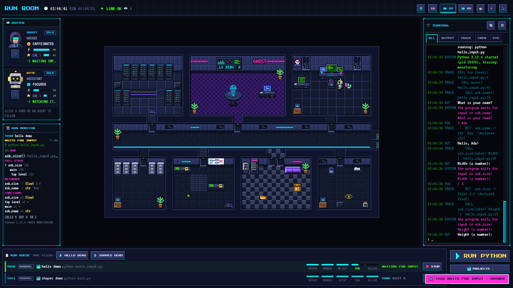
  <br>
  <sub><b>The whole HUD (1920 x 1080).</b> Roster and RUN MONITOR on the left, the office in the
  middle, the terminal on the right, the run queue at the bottom. The program is waiting for its
  third answer: the RUN MONITOR shows <code>ask_size()</code> on the call stack and what the first
  two questions returned.</sub>
</p>

<table>
  <tr>
    <td width="50%" valign="top">
      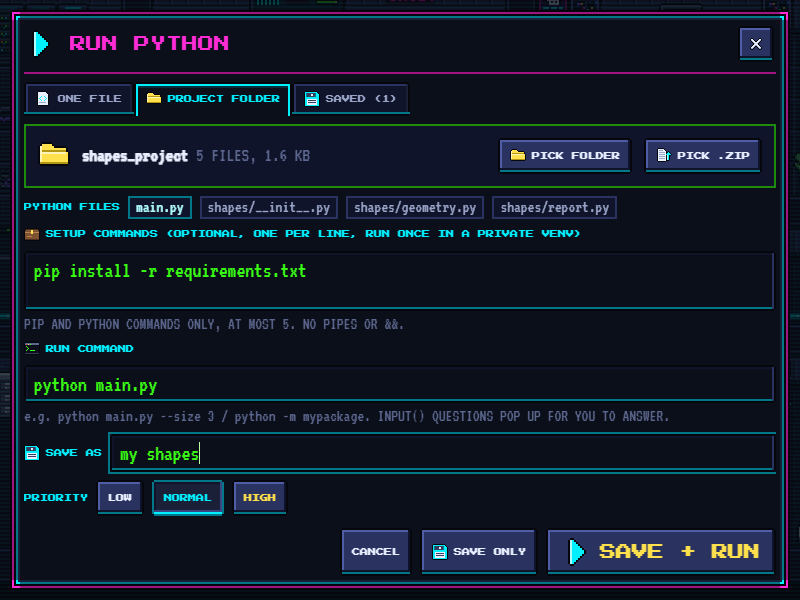
      <br><sub><b>RUN PYTHON.</b> A project folder with its Python files, a suggested setup
      command, the run command and SAVE AS.</sub>
    </td>
    <td width="50%" valign="top">
      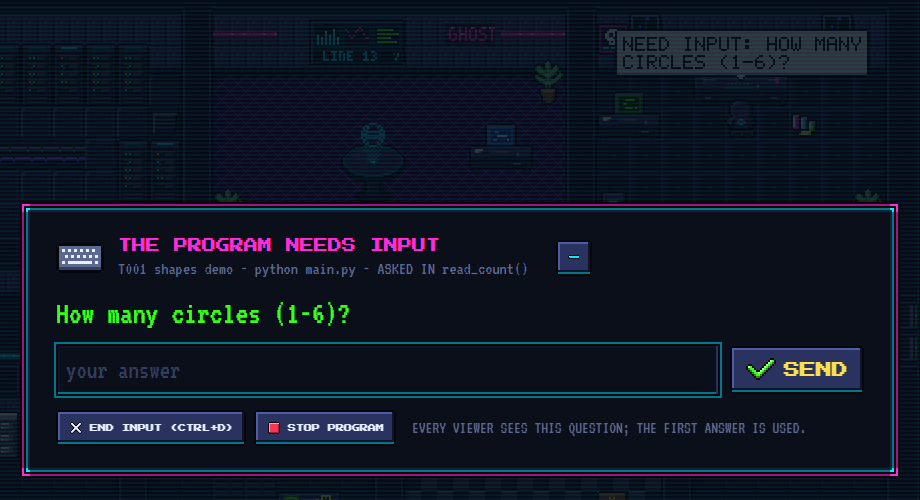
      <br><sub><b>The program asks.</b> <code>input()</code> pops up for every viewer while
      Ghost turns around: "Need input".</sub>
    </td>
  </tr>
  <tr>
    <td width="50%" valign="top">
      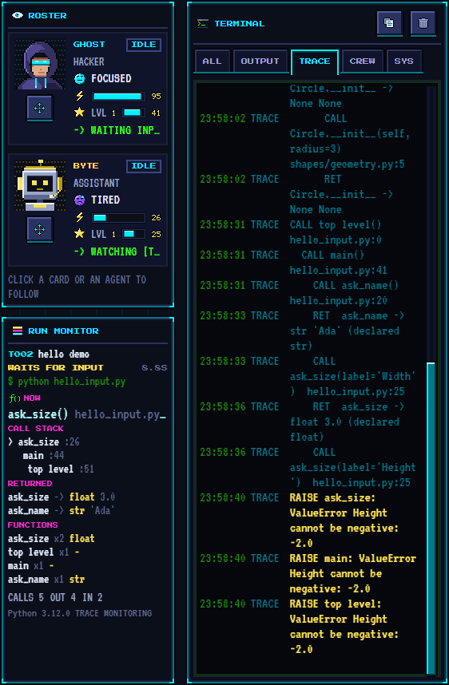
      <br><sub><b>RUN MONITOR and TRACE.</b> The function running now, the call stack, values
      returned with their types, and every CALL, RET and RAISE.</sub>
    </td>
    <td width="50%" valign="top">
      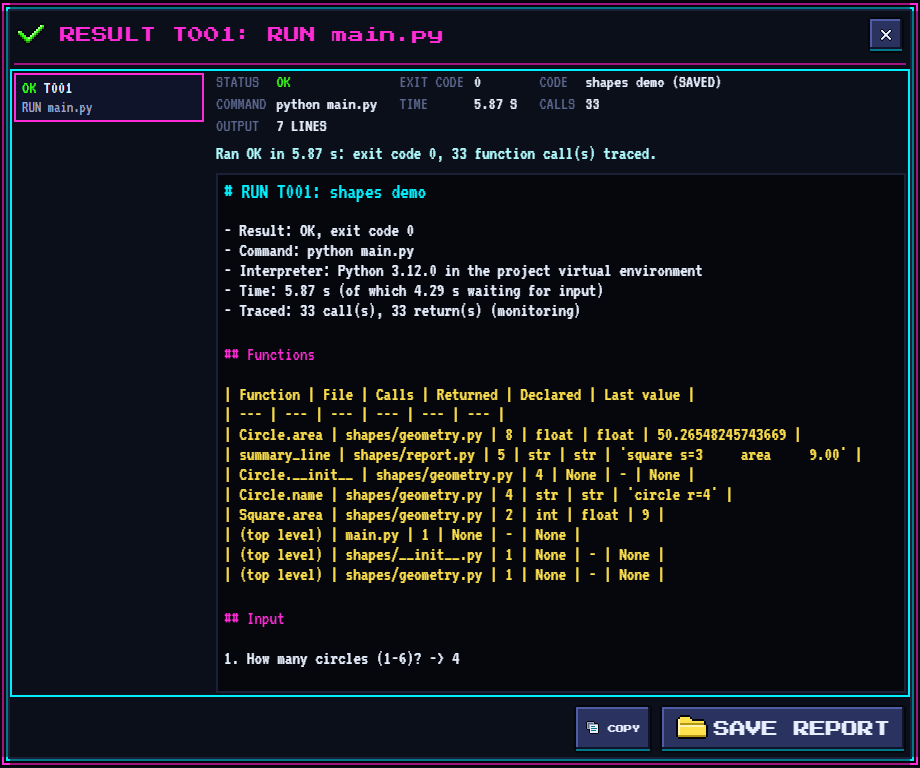
      <br><sub><b>The report.</b> Outcome, every traced function with its return types (here
      <code>Square.area</code> returns <code>int</code> but declares <code>float</code>), inputs
      and output.</sub>
    </td>
  </tr>
  <tr>
    <td width="50%" valign="top">
      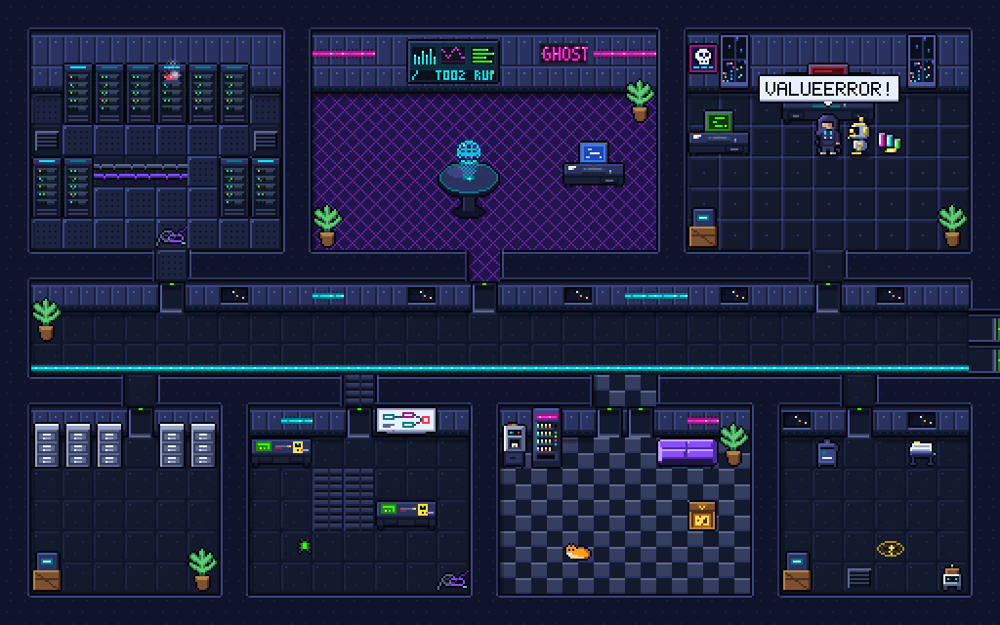
      <br><sub><b>A crash.</b> Red screen, a facepalm, "VALUEERROR!" and the rack siren.</sub>
    </td>
    <td width="50%" valign="top">
      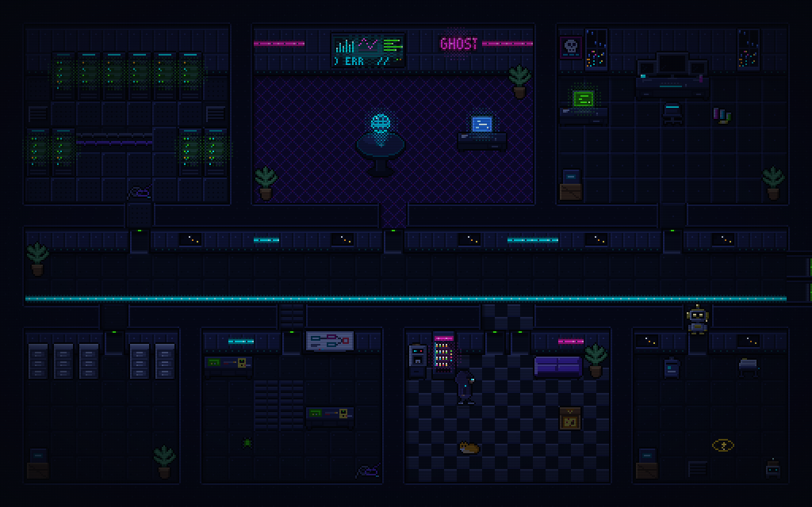
      <br><sub><b>Night mode + CRT filter.</b> Screens, neon and LEDs keep glowing.</sub>
    </td>
  </tr>
  <tr>
    <td width="50%" valign="top">
      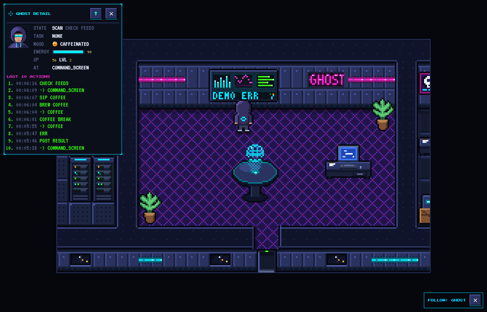
      <br><sub><b>Camera follow.</b> Click an agent: the camera follows him and his card lists
      his last ten actions.</sub>
    </td>
    <td width="50%" valign="top">
      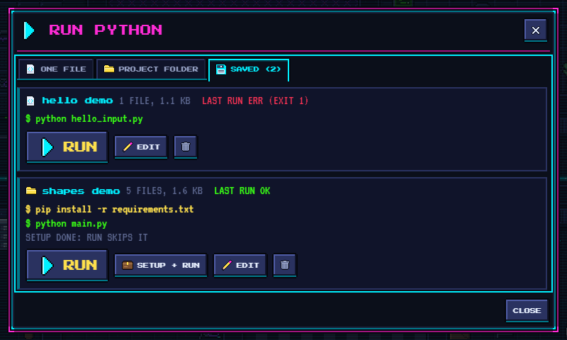
      <br><sub><b>Saved projects.</b> RUN, SETUP + RUN, EDIT and DELETE, with the last outcome.</sub>
    </td>
  </tr>
  <tr>
    <td width="50%" valign="top">
      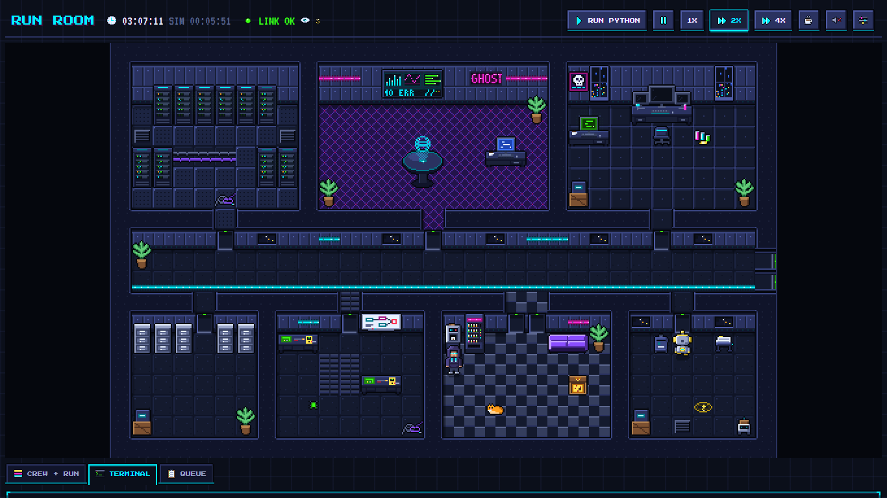
      <br><sub><b>Laptops and tablets.</b> Below 1600 px the panels move into tabs under the
      office, which keeps its 2x zoom.</sub>
    </td>
    <td width="50%" valign="top" align="center">
      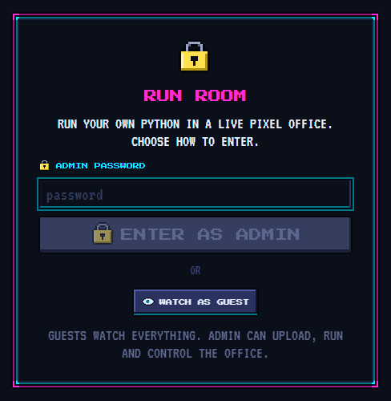
      <br><sub><b>Guests and admins.</b> With a password set, visitors choose: watch, or log in.</sub>
    </td>
  </tr>
</table>

<p align="center">
  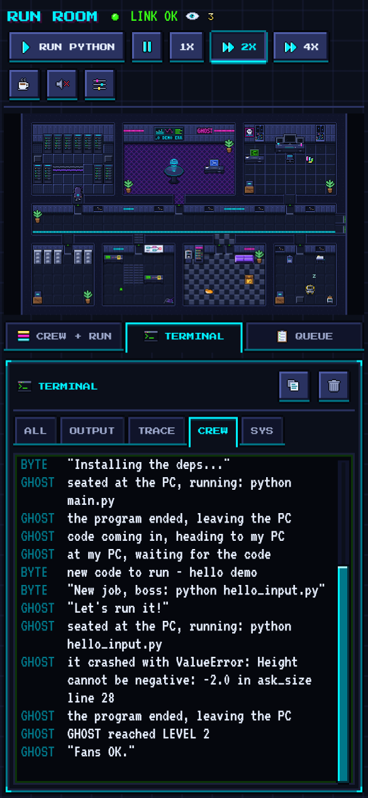
  &nbsp;
  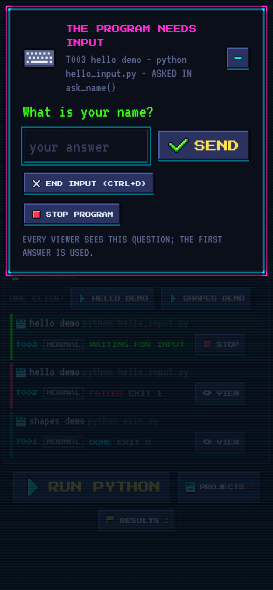
  &nbsp;
  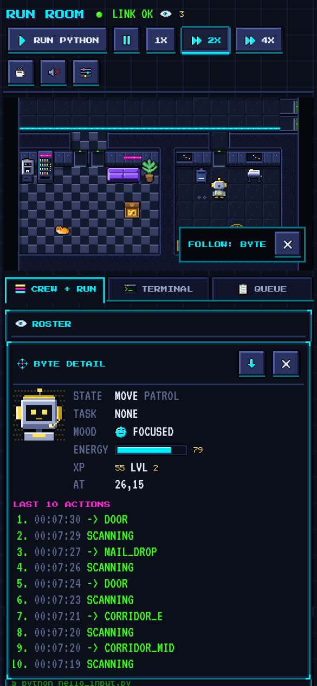
  <br>
  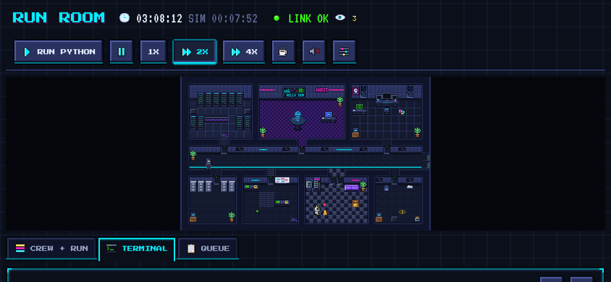
  <br>
  <sub><b>On a phone.</b> The crew's log, an input question and the agent card as a bottom sheet
  (iPhone 13 size), and the same office held sideways.</sub>
</p>

---

## Quick start

**You need**

- [Node.js](https://nodejs.org) 20 or newer (tested with Node 22) and npm
- [Python](https://www.python.org) 3.8 or newer (tested with 3.10 and 3.12). RUN ROOM finds it as
  `$PYTHON`, `python3`, `python` or `py -3`.
- A current browser (Chrome, Edge, Firefox or Safari)

Developed and tested on Windows 11. The server also handles macOS and Linux (POSIX process groups,
`bin/` virtual environments).

**Install and start**

Clone this repository (or download it as a ZIP from the green **Code** button and open a terminal
in its folder), then run:

```bash
git clone https://github.com/hackticaayush/run-room.git
cd run-room
npm install
npm run dev
```

Then open **http://localhost:5173**. Open the same address in a second tab to see one office in
two places at once.

`npm run dev` first regenerates the art (`npm run assets`, about a second), then starts:

- the simulation server on `http://127.0.0.1:8787` (Express + WebSocket at `/ws`, restarts on change)
- the Vite dev client on `http://localhost:5173` (proxies `/api` and `/ws` to the server)

**Your first run**

1. Press **RUN PYTHON** (bottom right, or in the top bar on smaller screens).
2. Choose **ONE FILE** and pick `samples/hello_input.py`. The run command `python hello_input.py`
   is filled in for you.
3. Optionally type a name under **SAVE AS** for one-click reruns.
4. Press **RUN** and accept the one-time warning.
5. Watch Ghost walk to his PC and answer the three questions. Type a negative size to see a crash.

Then try the folder `samples/shapes_project` with **PROJECT FOLDER**: it has a package with two
modules, a `requirements.txt` (so Byte runs `pip install -r requirements.txt` at the racks first)
and a question.

**Production build** (one port, no hot reload):

```bash
npm run build     # art, no-emoji check and the Vite build into client/dist
npm start         # http://localhost:8787
```

---

## How a run works

The office is a visual story, and it follows one rule: **nothing happens before the crew is
physically there.** The program never starts until Ghost sits at his PC, setup only starts when
Byte stands at the server racks, and Ghost's PC is used for runs only, so a lit PC screen always
means a program is running.

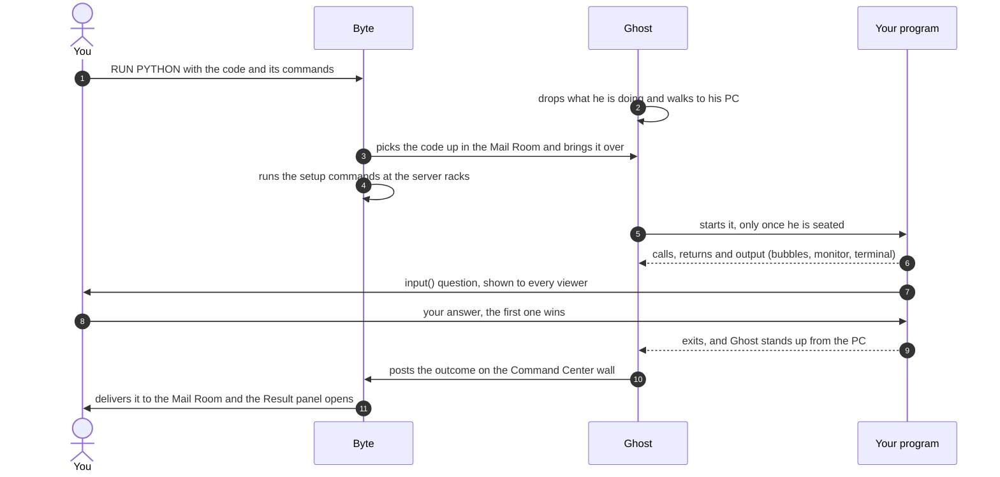

The queue shows each run's steps and what is physically happening (`GHOST -> PC`, `INSTALLING 1/1`,
`RUNNING AT PC`, `WAITING FOR INPUT` ...):

| Step | What you see |
| --- | --- |
| **INTAKE** | Ghost walks to his PC (waking up first if he was napping) while Byte picks the code up in the Mail Room. The PC boots when Ghost sits down. |
| **HANDOVER** | Byte brings the code to the PC: "New job, boss: python main.py". |
| **SETUP** | With setup commands, Byte carries them to the server racks and only there does the setup start. The racks blink fast while pip works. Failure: siren and smoke, the program is not started and the report shows the setup output. Without setup (or when a saved project's setup already ran) this step passes at once (NO SET / CACHED). |
| **RUN** | Only now, with Ghost seated, does the program start. Bubbles, the wall, the RUN MONITOR and the terminal follow it live. An uncaught exception turns the screen red, sounds the rack siren and Ghost facepalms. When the program ends the screen goes dark and Ghost leaves the PC. |
| **DELIVER** | Ghost posts the outcome on the Command Center wall (for example `T004 main.py: OK EXIT 0 1.2S`) and hands the result to Byte, who carries it to the Mail Room: XP coins, confetti on success, and the Result panel opens. |
| **COOLDOWN** | Ghost takes a coffee break. |

Runs are queued: HIGH before NORMAL before LOW, first in first out within a priority. The RUN step
lasts as long as the program runs, at any sim speed, and nothing times out while it waits for input.

---

## Using the office

- **Top bar:** local time and sim clock, link status and viewer count, then pause / resume,
  1X 2X 4X, send Byte for coffee, sound, ADMIN / LOG OUT (when a password is set) and settings.
- **Roster:** Ghost and Byte with their mood, energy, XP and level, and what they are doing.
  Click a card (or the agent in the office) to follow him with the camera; his detail card shows
  his last ten actions and folds away to its title bar with the arrow.
- **RUN MONITOR**, **terminal** and **run queue** as described above. **STOP** a running program
  or **CANCEL** a waiting one from the queue; a stopped run still delivers its report.
- **RESULTS** reopens the last 25 reports, **PROJECTS** opens the saved projects.
- **Settings** (per browser): CRT filter, night mode, sound, camera follow, collision grid / debug
  view and the typewriter terminal.
- Little things: click the cat for a purr, click a screen in the office to jump to the terminal.
- **Keys:** Enter sends an answer, Ctrl+D ends the program's input, Escape closes a dialog or tucks
  the input prompt away. Arrow keys and Page Up / Down scroll the open dialog.

---

## Running Python: the rules

**Commands** (`shared/commands.ts`, checked in the browser and again on the server)

- Every command starts with `python` (or `python3`, `py`, `py -3`) or `pip`. Anything else
  (`node`, `npm`, `bash`, a path to another program) is refused: only Python projects run here.
- There is no shell. A command is split into words (quotes group words, backslashes stay literal
  so Windows paths work) and started directly. Pipes, redirects, `;` and `&&` are refused: put one
  command per line in the setup box (at most 5).
- The run command must say what to run: `python main.py --size 3`, `python src/app.py`,
  `python -m mypackage` or `python -c "..."`. The script must be inside the project (no `..`, no
  absolute paths). `pip` belongs in the setup commands.
- Whatever spelling of python you type, RUN ROOM uses the interpreter it found, or the project's
  own virtual environment once it has one.

**Setup and virtual environments.** The first setup of a piece of code creates a private virtual
environment for it (`python -m venv --system-site-packages`, so packages you already installed keep
working) and runs the setup commands inside it, so `pip install ...` never touches your system
Python. A saved project keeps its environment in `data/projects/<id>/venv` and only runs its setup
again when the commands or the code change (or when you press SETUP + RUN). Unsaved uploads get a
fresh environment next to the upload, deleted with it after a day. Setup commands get no input
(pip runs with `PIP_NO_INPUT`).

**What the tracer reports.** The program runs under a small harness
(`server/runners/python/runroom_harness.py`) that behaves like `python your_script.py` (same
`sys.argv`, `sys.path[0]`, `__main__`, exit codes and traceback) and reports on a private pipe:

- calls of the program's own functions with their arguments, and returns with the value, its type
  and the declared return annotation; generator yields; exceptions passing through
- the current call stack, sampled five times a second (so a long loop in one function still shows
  its current line)
- per function totals (calls, return types seen, last value), once a second
- every read of stdin with the question and the function that asked
- an uncaught exception with its function and line, and the exit code

At most 60 call / return events per second reach the office (the totals still count everything),
and the terminal shows up to 8 TRACE lines and 40 output lines per second (the report keeps the
full output, up to 1 MB per stream). Tracing slows down programs that make millions of tiny calls;
set `RUNROOM_TRACE=off` to run them at full speed.

**Input.** The question goes to every viewer that may run code; the first answer is written to the
program's stdin and the others get "already answered". Programs that need a real terminal
(`curses`, `msvcrt.getch`, raw keyboard reading, terminal size) are not supported: their stdin and
stdout are pipes.

**Limits.** One `.py` file up to 1 GB; a project up to 2000 files and 1 GB (uploads stream to disk,
never into memory); setup and run commands up to 300 characters; one input line up to 4000
characters; a program runs at most 60 minutes (time waiting for input does not count) and STOP
kills it together with everything it started. Text from your program is cleaned before it is shown
(`shared/display.ts`): terminal colour codes are removed, carriage-return progress bars show their
last state, and emoji or symbol characters appear as `[U+XXXX]`.

**Where things are stored.** Uploads in `server/uploads/<id>/files` (swept after a day), saved
projects in `data/projects` (or `RUNROOM_DATA_DIR/projects`). Neither is ever served over HTTP and
both are git-ignored. The program's working directory is its code folder, so files it writes stay
there, and the report lists them.

---

## Share it with other people

By default RUN ROOM listens on `127.0.0.1` and has no password: only browsers on your own computer
can reach it, and they all have full access. To let other devices in (your phone on the same Wi-Fi,
a friend, a server on the internet), set an **admin password**:

```bash
cp .env.example .env              # then set RUNROOM_ACCESS_PASSWORD in .env
npm run build
npm run start:public              # listens on 0.0.0.0:8787 and prints your network addresses
```

Everyone who opens the page can now **watch as a guest**; the password unlocks **full access**
(upload, run, save, answer input, pause, speed). `npm run dev:public` does the same with hot reload
(other devices then use port 5173). The server refuses to listen on the network without a password
and warns when it is shorter than 12 characters.

On the open internet, use a long random password, put RUN ROOM behind HTTPS (a reverse proxy such
as Caddy or nginx, with the public origin in `RUNROOM_ALLOWED_ORIGINS` if needed) so the password
never travels in clear text, and run it as a locked-down user in a container or VM with CPU, memory
and network limits. `RUNROOM_RUN=off` turns it into a pure show where nothing runs.

---

## Configuration

**npm scripts**

| Script | What it does |
| --- | --- |
| `npm run dev` | art + server + client with hot reload (this computer only) |
| `npm run dev:public` | like `dev`, reachable from other devices (needs `RUNROOM_ACCESS_PASSWORD`) |
| `npm run build` | art + no-emoji check + Vite production build into `client/dist` |
| `npm start` | server that also serves `client/dist` on one port (this computer only) |
| `npm run start:public` | the same, reachable from other devices (needs the password) |
| `npm run assets` | runs the art generator (also runs before `dev`, `build` and `check`) |
| `npm run check` | no-emoji check + typecheck (server and client) + lint + all tests |
| `npm test` | the tests only (vitest) |
| `npm run check:emoji` | the hard rule checker alone |

**Environment variables** (put them in a `.env` file in the repo root, see
[`.env.example`](.env.example); a real environment variable wins over the file)

| Variable | Default | Meaning |
| --- | --- | --- |
| `RUNROOM_ACCESS_PASSWORD` | (unset) | admin password: visitors watch, the password unlocks full access |
| `PORT` | `8787` | HTTP + WebSocket port (the Vite proxy follows it) |
| `HOST` | `127.0.0.1` | listen address; `--public` or `RUNROOM_PUBLIC=1` makes it `0.0.0.0` |
| `RUNROOM_PUBLIC` | (unset) | `1` = listen on the network (same as `--public`); needs the password |
| `RUNROOM_ALLOWED_ORIGINS` | (unset) | extra browser origins allowed to connect, comma separated |
| `RUNROOM_RUN` | (on) | `off` switches running code off (the office is then only a show) |
| `RUNROOM_DATA_DIR` | `./data` | where saved projects live (`data/projects`) |
| `RUNROOM_TRACE` | `auto` | `auto`, `monitoring`, `profile` or `off` (function call tracing) |
| `RUNROOM_RUN_TIMEOUT_MIN` | `60` | time limit of one program, not counting time waiting for input |
| `RUNROOM_SETUP_TIMEOUT_MIN` | `20` | time limit of one setup command |
| `SIM_TICK_RATE` | `60` | simulation ticks per second |
| `PYTHON` | (unset) | the Python 3 interpreter to use (a path or a command) |

---

## Security model

Watching is open; running code (and every other command) is **admin only**. There are no links,
QR codes or network checks: access is decided by the admin password alone.

- **Open mode** (no password): everyone who connects is admin. Meant for your own computer, where
  the server only listens on `127.0.0.1`.
- **Password mode:** anyone, on any device or network, may open the page and watch as a guest.
  Entering the password (`POST /api/login`) returns a session token that the browser keeps and sends
  on the WebSocket and on uploads. Tokens live in memory only, so a restart signs everyone out.
  Wrong-password attempts are rate limited.
- Guests are turned away **on the server**, not just in the UI: a guest's command, upload or input
  answer is refused.
- While the server listens only on this computer, password or not, Host / Origin checks refuse
  foreign web pages and DNS rebinding (a site you visit could otherwise reach localhost and try a
  guessable password).
- The admin password is removed from the environment of every program you run, because program
  output is shown to every viewer, guests included.
- Commands never go through a shell, only `python` and `pip` start, scripts must be inside the code,
  uploaded paths are checked (no `..`, no absolute paths, no device names), and uploads and projects
  are never served back. Each browser shows a one-time warning before its first run.
- It is still **not a sandbox**: a program can do anything the server's user account can (files,
  network, other programs), and whoever has the admin password can run code on the server.

---

## Architecture

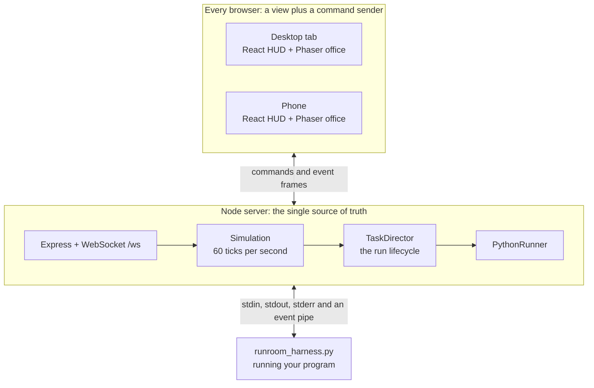

- The simulation runs **only on the server** (`server/sim/Simulation.ts`) and never stops, whether
  anyone watches or not: one Ghost, one Byte, one queue, one clock, one program at a time.
- Each tick it processes the commands of all clients, pumps the running program's output and
  events, advances the director, the idle behaviours and the agents, then broadcasts that tick's
  events to **every** client as one frame.
- Clients never simulate and never predict. They mirror the world (`client/src/net/store.ts`) and
  draw it with the shared sim clock. Movement is deterministic: a path, a start time and a speed,
  sampled the same way on the server and in every browser.

**Repository layout**

```text
client/                     Vite + React HUD + Phaser office
  src/game/                 Phaser scenes and renderers (map, props, agents, FX, bubbles)
  src/hud/                  RunBox, InputPrompt, RunMonitor, terminal, queue, results ...
  src/ui/                   the pixel UI kit (PixelButton, PixelPanel, PixelScroll ...)
  src/net/                  WebSocket link, world store, upload helpers
  src/assets/manifest.ts    GENERATED: the only place code looks up art
  public/assets/            GENERATED art (sprites, atlases, bitmap fonts, contact sheets)
server/
  sim/                      Simulation, Agent, FSM, TaskDirector, idle behaviours
  runners/                  TaskRunner interface, PythonRunner
  runners/python/           runroom_harness.py (the tracer), process helpers, report builder
  net/                      broadcast registry, security (origins, hosts, admin tokens)
  upload.ts, projects.ts    uploads and saved projects (never served)
shared/                     types, event protocol, command rules, office layout, pathfinding
tools/assets/               the art generator (palette, drawing library, art modules)
scripts/check-no-emoji.mjs  the hard rule checker
samples/                    hello_input.py, shapes_project/
tests/                      vitest suites
art/overrides/              optional hand-drawn replacements for generated sprites
docs/media/                 the README images
```

The whole map lives in **one** file, `shared/officeLayout.ts`: a 32 x 20 grid of 16 px tiles, every
prop placement and the named stations (`DESK_GHOST`, `SERVER_CHECK`, `MAIL_DROP`, `COFFEE` ...). The
client renders from it and the server builds its collision grid and A* pathfinding from the same data.

<details>
<summary><b>Event protocol</b> (shared/events.ts)</summary>

<br>

Every server frame is a JSON **array** of envelopes `{ type, payload }`. Every client message is
**one** envelope.

**Server to all clients**

| type | payload |
| --- | --- |
| `STATE_SNAPSHOT` | agents, taskQueue, clock, world, logs, results, dialogues, fx, clients, projects, run |
| `CLOCK` | worldClock, speed, paused, serverTime, propAnimFrame |
| `AGENT_STATE` | the full agent (state, station, mood, energy, xp, level, activity, anim, x, y, move ...) |
| `AGENT_MOVE` | agentId, path `[[x, y], ...]`, startClock, speed |
| `DIALOGUE` | id, from, to, text, duration, kind (speech or thought), startClock |
| `LOG` | id, level, source, text, timestamp, channel (stdout, stderr, trace, input, setup, chat, runner, system) |
| `TASK_UPDATE` | taskId, status, stepIndex, steps, progress, task (code, setup, run, note, exitCode ...) |
| `RUN_STATE` | the run monitor: phase, command, current frame, stack, lastReturns, top functions, counters, exception, waitingInput, exitCode, outcome |
| `INPUT_REQUEST` | taskId, requestId, prompt, secret, fn, since, context (last output lines) |
| `INPUT_DONE` | taskId, requestId, by, shown, cancelled |
| `PROJECTS` | projects (name, kind, entry, files, setup, run, setupDone, lastRun ...) |
| `RESULT` | taskId, title, summary, report, codeName, command, projectName, ok, outcome, exitCode, runtimeMs, calls, outputLines |
| `FX` / `AMBIENT` / `CLIENTS` | effects, shared props (racks, wall text, desk screen ...), viewer count |

**Server to one client:** `HELLO` (clientId, config: runEnabled, canRun, role, passwordRequired,
python, limits), the snapshot on connect, `NOTICE` (a refused command and why).

**Clients to server:** `SUBMIT_TASK` (source: an upload id or a project id, setup?, run?, priority,
saveAs?, overwrite?, forceSetup?), `SAVE_PROJECT`, `UPDATE_PROJECT`, `DELETE_PROJECT`,
`PROVIDE_INPUT` (taskId, requestId, value, eof?), `CANCEL_TASK`, `PAUSE`, `RESUME`, `SET_SPEED`,
`GIVE_COFFEE`, `PET_CAT`, `REQUEST_SNAPSHOT`.

Code is uploaded first with `POST /api/upload/file` (one `.py`), `POST /api/upload/folder` (a
`manifest` JSON list of relative paths plus the files) or `POST /api/upload/zip`; the answer is an
opaque upload id and a summary (entry file, `.py` files, requirements file). `POST /api/login` and
`POST /api/logout` handle admin sessions, `GET /api/health` answers health checks.

</details>

<details>
<summary><b>The runner interface</b> (server/runners/TaskRunner.ts)</summary>

<br>

```ts
interface TaskRunner {
  name: string;
  setup(task: RunnerTask, ctx: RunnerContext): AsyncIterable<RunnerEvent>; // ends with setup_done
  run(task: RunnerTask, ctx: RunnerContext): AsyncIterable<RunnerEvent>;   // ends with result
}
```

`RunnerTask` has the code folder, the venv folder and the parsed setup and run commands.
`RunnerContext` has an `AbortSignal` (STOP / CANCEL) and an `InputBridge` that delivers typed lines.
Runner events: `log`, `stdout`, `stderr`, `hello`, `call`, `return`, `unwind`, `stack`, `stats`,
`input_request`, `input_done`, `exception`, `setup_step`, `setup_done`, `exit`, `result`, `error`.
The director decides **when** a stage starts (setup at the racks, the program at the PC) and turns
the events into the show. `PythonRunner` is the only runner; the tests use a scripted fake runner
(`tests/helpers/fakeRunner.ts`). Pass your own with `startRunRoomServer({ runner })`.

Adapters (`server/sim/sources.ts`): a `TaskSource` can queue runs from anywhere through
`sim.submitTask(input)`, and an `EventSource` can replace the built-in lifecycle:
`sim.useEventSource(source)` hands it a sink with `step()`, `log()`, `say()` and `result()`.

</details>

<details>
<summary><b>How multi-client sync works</b></summary>

<br>

- **One authoritative clock.** The server owns `worldClock` (sim milliseconds). It advances with the
  speed multiplier and freezes while paused (a running program does not pause: its output and input
  prompts keep flowing).
- Every client mirrors the clock (`shared/clock.ts`) and extrapolates it; two tabs agree on sim time
  to a few milliseconds (measured at 4x: within 15 ms, about 0.06 tiles).
- **Deterministic movement.** `AGENT_MOVE` sends a tile path, a start time and a speed; the position
  at sim time T is `sampleMove(move, T)` on the server and in every client. No positions are streamed.
- Animation frames, bubbles and particles are pure functions of sim time and event ids.
- Input prompts are shared state: everyone sees the same question, the first answer is used and every
  prompt closes (`INPUT_DONE`). A late joiner gets an open question in its snapshot.
- Only per-viewer things are local: camera follow, open panels, sound, CRT and night settings.

</details>

<details>
<summary><b>Add more agents</b></summary>

<br>

1. Add an entry to `AGENT_DEFS` in `shared/agents.ts` (id, name, role, sprite key, portrait key, home
   station, walk speed, idle profile, accent colour).
2. Draw a character sheet in `tools/assets/art/characters.mjs` (the same 6 x 5 layout of 16 x 24
   frames), add it to `characters.json`, add a portrait and an emissive rule, then run
   `npm run assets`.
3. Give it behaviour in `server/sim/behaviors.ts`. The `TaskDirector` casts Ghost and Byte; give the
   new agent phases there if it should take part in runs.

</details>

---

## The art pipeline

```bash
npm run assets      # node tools/assets/generate.mjs, about a second
```

`tools/assets` draws **every** image with code and writes PNG + JSON into `client/public/assets`
plus the typed manifest `client/src/assets/manifest.ts`. It is deterministic (seeded random) and
idempotent (files are only rewritten when their bytes change), so the generated art is committed to
this repository and a fresh run produces exactly the same files.

- `lib/palette.mjs` holds **the** palette. Drawing with any other colour throws, and every sheet is
  audited after generation.
- `lib/canvas.mjs` draws pixels, rectangles, lines, ellipses, flood fills, ASCII art sprites,
  mirrors, palette swaps, outlines and integer scaling; `lib/atlas.mjs` packs Phaser atlases;
  `lib/font.mjs` holds two hand-made pixel fonts (5x7 and 3x5) exported as bitmap fonts.
- `art/*.mjs`: 47 tiles, 54 props, 28 effects, 49 UI icons, 5 mood faces, 18 UI frames (9-slice),
  2 character sheets, 2 portraits, the cursors and the favicon.

<p align="center">
  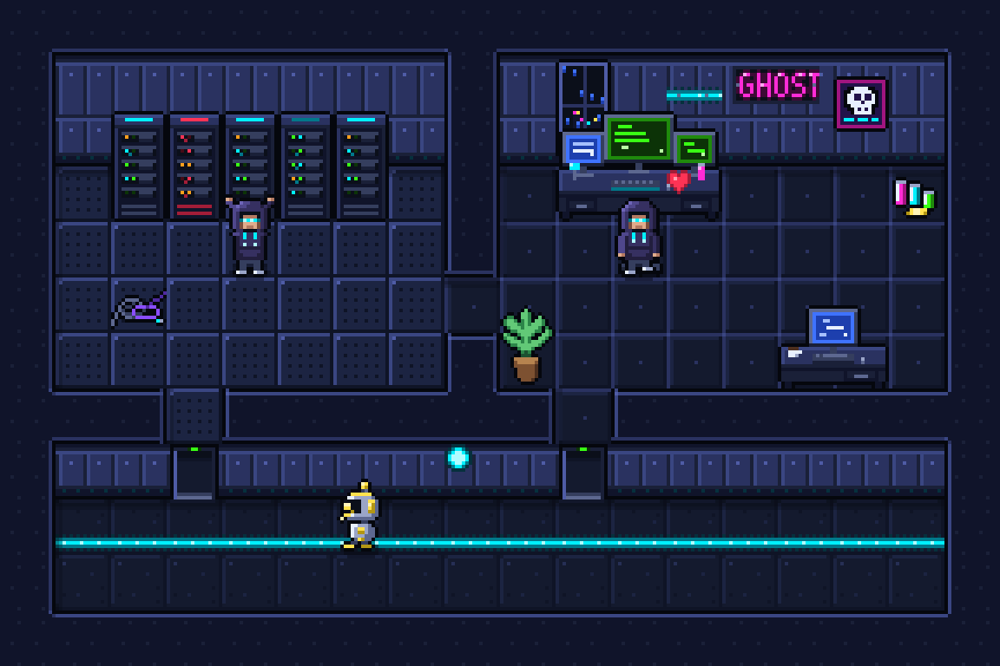
  <br>
  <sub>The generator's own preview scene (<code>client/public/assets/sheets/preview.png</code>).</sub>
</p>

<details>
<summary><b>Contact sheets of every generated sprite</b></summary>

<br>

| Characters | Props |
| --- | --- |
| 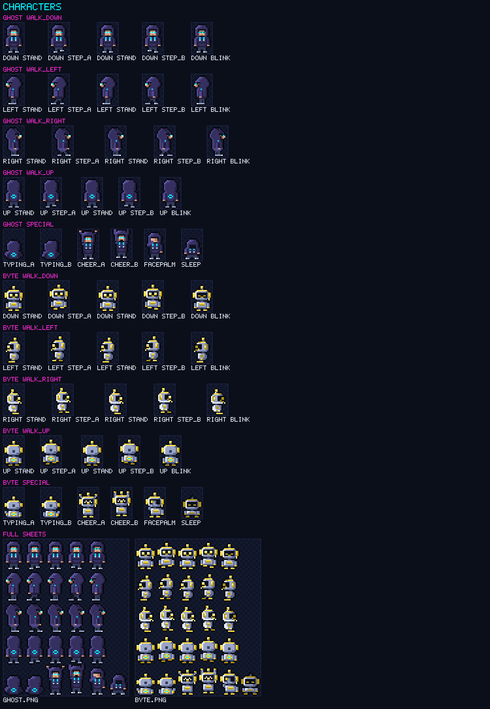 | 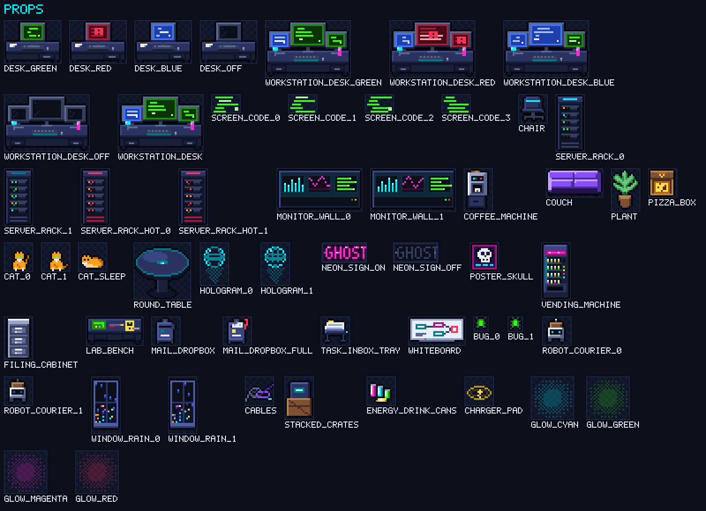 |

| UI: icons, cursors, mood faces, 9-slice frames, portraits | Tiles |
| --- | --- |
| 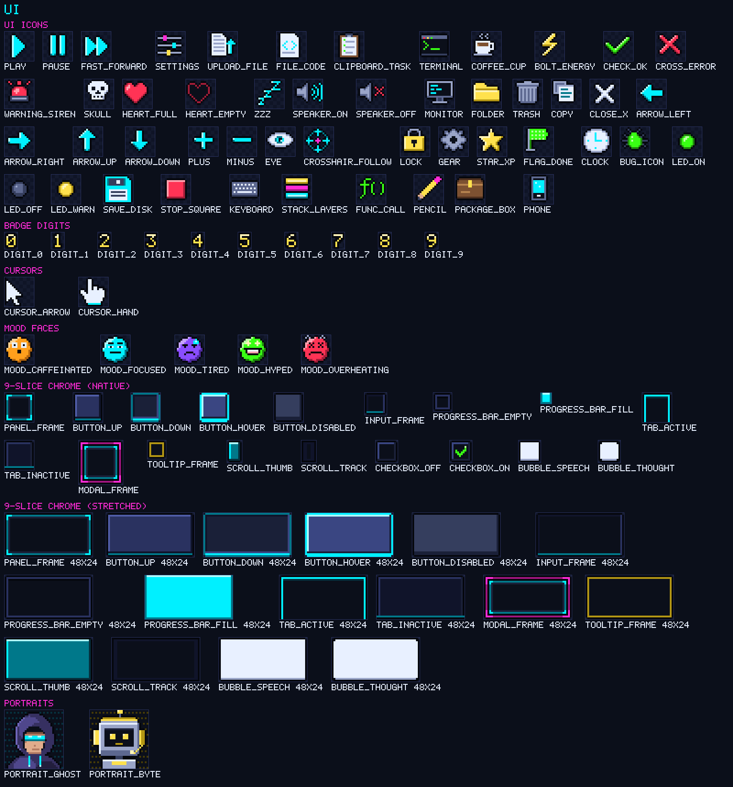 | 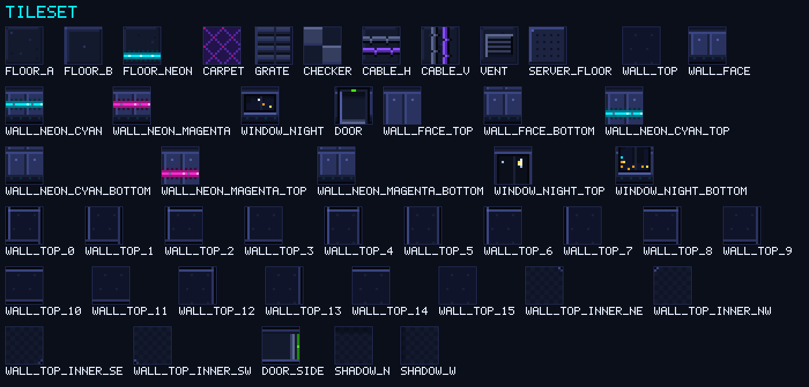 |

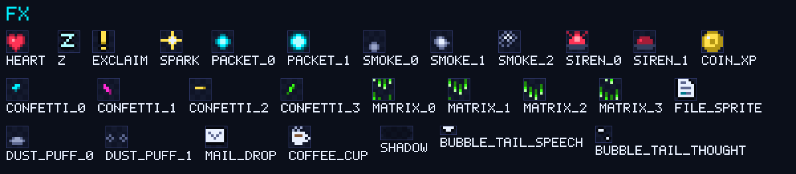

</details>

Open **http://localhost:5173/assets-test** while `npm run dev` runs to see every asset with its name,
the animations playing, and the live UI kit:

<p align="center">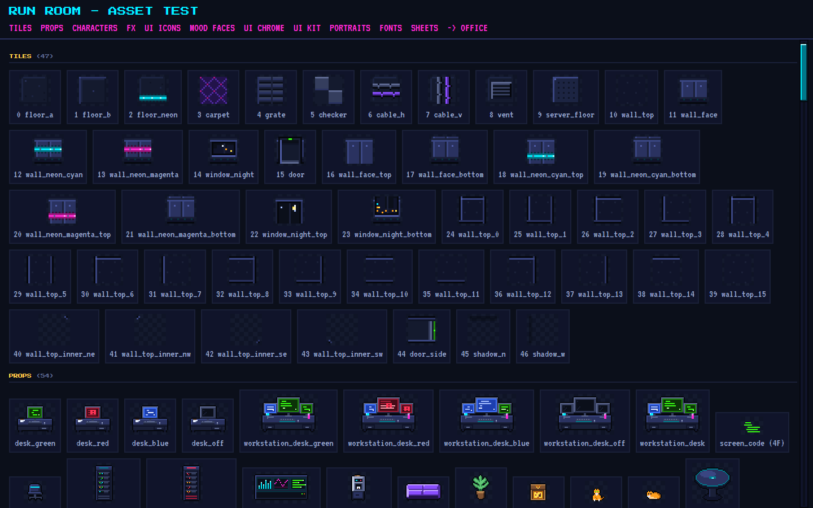</p>

**Change a sprite:** edit its module in `tools/assets/art` (most small sprites are ASCII art: each
character maps to a palette colour through a legend), run `npm run assets` and look at the contact
sheets or `/assets-test`. **Add an icon:** add an entry (16 rows of 16 characters) to the `ICONS`
list in `tools/assets/art/icons.mjs` and run `npm run assets`; the name becomes part of the
`IconName` type, so `<PixelIcon name="my_icon" />` is type checked.

**Swap in hand-drawn art without touching code:** put PNG files in
`art/overrides/<group>/<name>.png` and run `npm run assets` (see
[art/overrides/README.md](art/overrides/README.md) for the groups and sizes).

---

## Checks and tests

```bash
npm run check
```

runs the hard rule checker, the TypeScript typecheck (server and client), ESLint with zero warnings
allowed and the full test suite: **110 tests in 14 files**, all green. The tests cover the command
rules, uploads (unit and HTTP: files, folders, zips), the saved project store, the Python runner and
harness with a real interpreter (tracing, declared types, input, getpass, end of input, crashes,
`-m` and `-c`, STOP, the time limit, setup in a venv), the run lifecycle with a scripted runner (phase
order, setup only at the racks, setup failure, the PC rule, input from two viewers, input while
paused, STOP, crashes that stay on screen, priorities, saved projects with setup caching), security
(origins, DNS rebinding, the admin password and tokens, guests cannot run code), multi-client sync
and input over real WebSockets, pathfinding, the state machine, the art generator and the clock.

**The hard rules** (the full list is in [CLAUDE.md](CLAUDE.md)): no emoji or unicode symbol icons
anywhere (UI, logs, comments, commit messages, this README), no icon libraries or icon fonts, no
default browser look, every icon, button glyph, mood face, status light, avatar and cursor is a
generated pixel sprite, text uses only the bundled Press Start 2P and VT323 fonts, and sprites render
pixelated at integer scales. `scripts/check-no-emoji.mjs` enforces the text rules on every source
folder, the docs and the GitHub files, and runs in `npm run check` and before every build. Text that
comes from your programs goes through `shared/display.ts`, so the HUD keeps those rules too.

---

## FAQ and troubleshooting

<details>
<summary><b>Is it safe to run code from the internet in it?</b></summary>

<br>

No. RUN ROOM is not a sandbox: programs run as normal processes with the permissions of the user
that started the server. Run only code you wrote yourself or fully trust, and see the
[security model](#security-model).

</details>

<details>
<summary><b>"No Python 3.8+ found"</b></summary>

<br>

Install Python 3 from [python.org](https://www.python.org) or start the server with `PYTHON` set to
the interpreter (a path or a command). On Windows the `python3` Microsoft Store stub is skipped
automatically.

</details>

<details>
<summary><b>"could not create a virtual environment"</b></summary>

<br>

Some Linux distributions ship venv separately: `sudo apt install python3-venv`. Until then the setup
runs with the system Python.

</details>

<details>
<summary><b>pip fails during setup</b></summary>

<br>

pip needs the internet to fetch new packages; the report shows pip's full output. Setup commands get
no input, so packages that ask questions while installing cannot be answered.

</details>

<details>
<summary><b>My program is slow</b></summary>

<br>

It may make millions of function calls, and each one is traced. Try `RUNROOM_TRACE=off`; the
monitor then only shows output. Python 3.12+ traces much more cheaply (`sys.monitoring`).

</details>

<details>
<summary><b>The program waits but no prompt shows up</b></summary>

<br>

It probably reads the keyboard directly (`curses`, `msvcrt.getch`), which needs a real terminal and
is not supported. STOP it from the queue.

</details>

<details>
<summary><b>The office looks small</b></summary>

<br>

The canvas only uses whole-number zoom so the pixels stay sharp. Below 1600 px window width the side
panels move into tabs under the office (CREW + RUN, TERMINAL, QUEUE) and the office takes the window
height, so a 1366 x 768 laptop still gets 2x. Click an agent for a 2x camera that follows him.

</details>

<details>
<summary><b>npm install fails with "Cannot read properties of null (reading 'edgesOut')"</b></summary>

<br>

A known npm 10 peer resolution bug. Use `npm ci` or `npm install --legacy-peer-deps`.

</details>

<details>
<summary><b>The port is in use</b></summary>

<br>

Set `PORT` for the server; the Vite dev proxy follows it.

</details>

---

## Contributing

Issues and pull requests are welcome. Please keep the [hard rules](#checks-and-tests) (they are what
makes the office look the way it does) and run `npm run check` before you open a pull request.
Ideas that fit well: new idle behaviours, new props and rooms in `shared/officeLayout.ts`, more
agents, and support for more kinds of Python programs.

---

## Credits

- **Fonts:** [Press Start 2P](https://fonts.google.com/specimen/Press+Start+2P) (The Press Start 2P
  Project Authors) and [VT323](https://fonts.google.com/specimen/VT323) (The VT323 Project Authors),
  both under the SIL Open Font License 1.1, bundled through [Fontsource](https://fontsource.org).
- **Built with** [Phaser](https://phaser.io), [React](https://react.dev), [Vite](https://vite.dev),
  [Express](https://expressjs.com), [ws](https://github.com/websockets/ws),
  [EasyStar.js](https://github.com/prettymuchbryce/easystarjs), multer, yauzl and
  [Vitest](https://vitest.dev).
- **Art:** every sprite, tile, icon, cursor and bitmap font is generated by the code in
  `tools/assets`.
